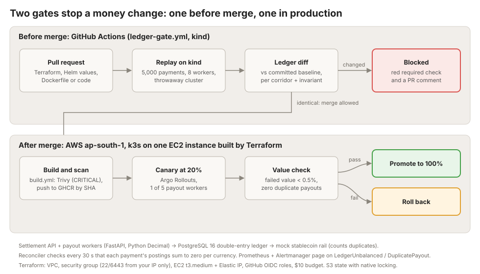
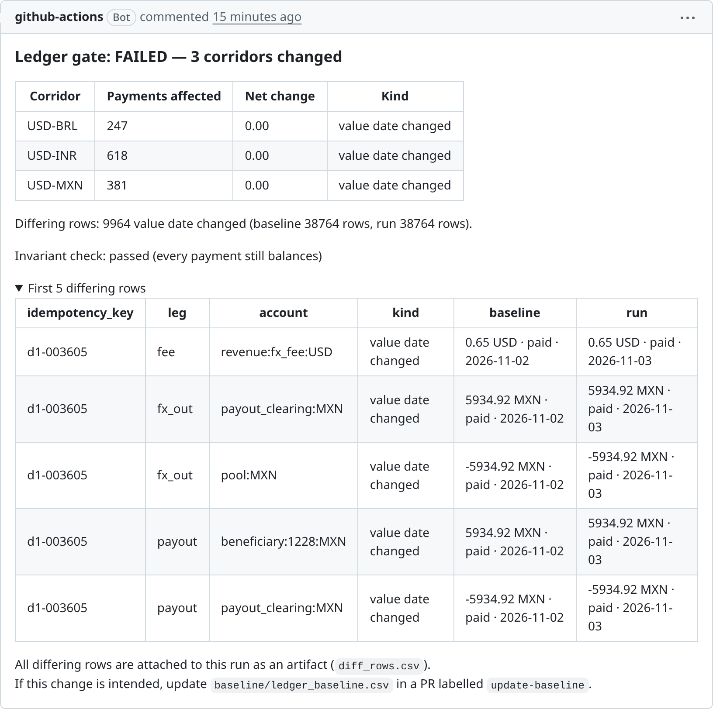
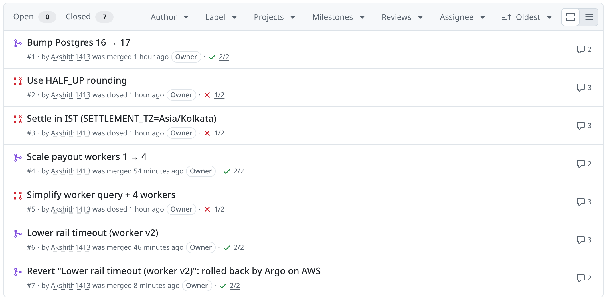
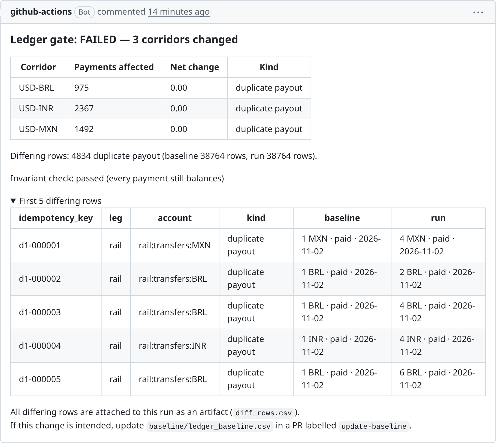
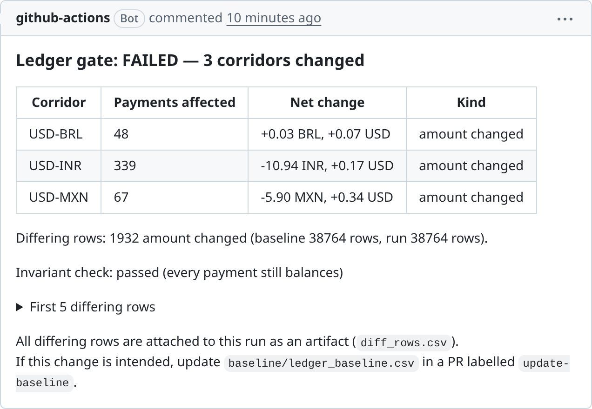
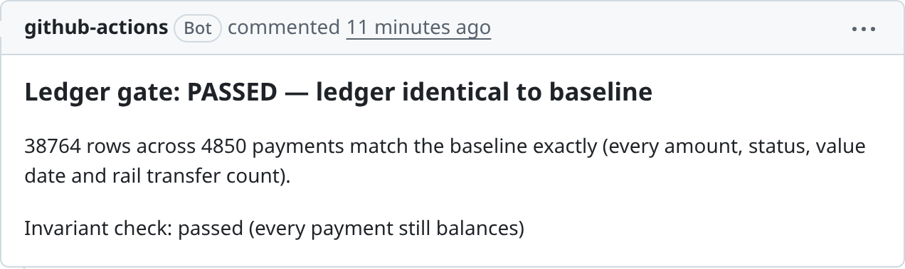
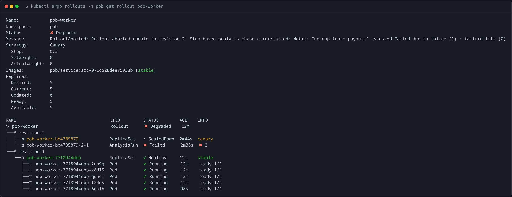
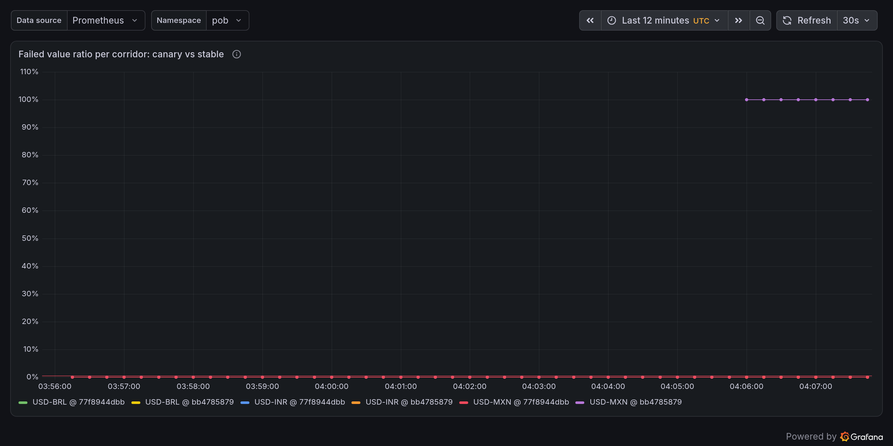
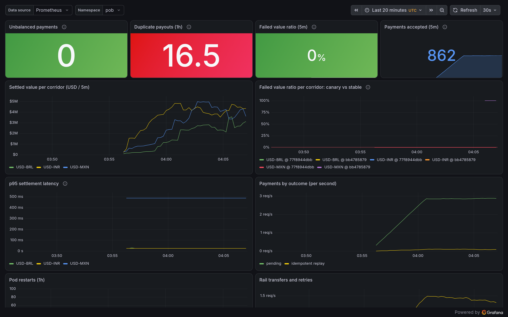
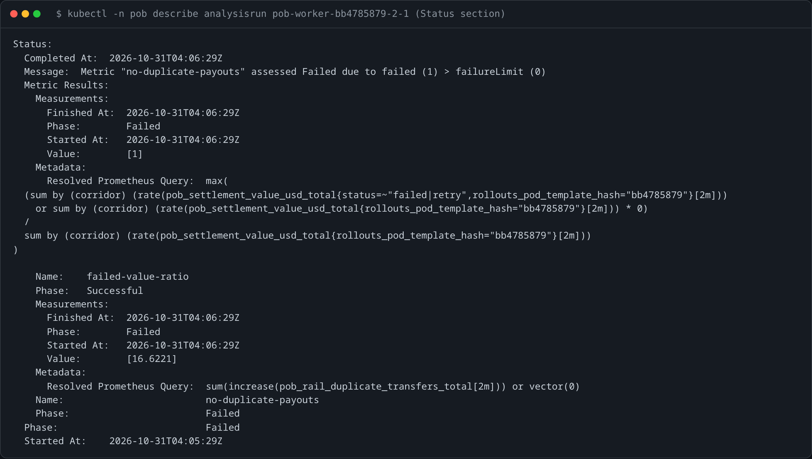

# ProofOfBalance

**A CI gate that blocks infrastructure changes that would move money in a ledger.**



**[Demo PR #3](https://github.com/Akshith1413/ProofOfBalance/pull/3) moves settlement to IST. It sounds harmless. The gate says otherwise:**



## How it works

- **Deterministic ledger service.** `Decimal` money (a float raises), `uuid5` ids, timestamps from the request, rounding mode and
  settlement time zone from config: the same traffic always produces the same double-entry ledger, byte for byte.
- **One recorded day of traffic.** `traffic/day1.jsonl` holds 5,000 payments from a fixed seed, with half-cent amounts, retried
  idempotency keys and an evening burst that crosses midnight IST.
- **Gate 1, before merge.** Every PR boots the chart on a throwaway kind cluster, replays the day, exports every posting plus how many
  transfers the *rail* received, and diffs that against `baseline/ledger_baseline.csv`. Any difference fails the required check and the PR
  comment says which corridor, how much and what kind.
- **Gate 2, in production.** Payout workers ship as an Argo Rollouts canary on k3s (AWS). The canary is judged on **value**: rolled
  back if its failed or timed-out USD value in any corridor exceeds 0.5%, or if the rail sees a single duplicate payout.
- **Everything is reproducible.** `scripts/setup.sh` builds the whole AWS environment in one idempotent run; `scripts/teardown.sh`
  destroys it and verifies nothing is still billing. Both write a plain-English status file when something fails.

## Demo pull requests

Real PRs, left visible. Each ran the full gate on GitHub Actions.

| # | PR | What it changes | Result |
|---|---|---|---|
| 1 | [Bump Postgres 16 → 17](https://github.com/Akshith1413/ProofOfBalance/pull/1) | image tag in Helm values | ✅ passed: 38,764 ledger rows identical. **Merged** |
| 2 | [Use HALF_UP rounding](https://github.com/Akshith1413/ProofOfBalance/pull/2) | `ROUNDING_MODE` in Helm values | ❌ 454 half-cent payments change amount in all three corridors. Closed |
| 3 | [Settle in IST](https://github.com/Akshith1413/ProofOfBalance/pull/3) | `SETTLEMENT_TZ=Asia/Kolkata` | ❌ 1,246 payments after 18:30 UTC move to the next value date. Closed |
| 4 | [Scale payout workers 1 → 4](https://github.com/Akshith1413/ProofOfBalance/pull/4) | replica count | ✅ passed, thanks to `FOR UPDATE SKIP LOCKED`. **Merged** |
| 5 | [Simplify worker query + 4 workers](https://github.com/Akshith1413/ProofOfBalance/pull/5) | removes `SKIP LOCKED` | ❌ 4,834 payments paid more than once at the rail (up to 6×), while unit tests passed and the ledger still balanced. Closed |
| 6 | [Lower rail timeout (worker v2)](https://github.com/Akshith1413/ProofOfBalance/pull/6) | `RAIL_TIMEOUT_MS` 2000 → 100 | ✅ passed CI, **merged**, then Argo **rolled it back on AWS** within a minute: the MXN rail answers in 300 ms, so the canary's MXN failed value hit 100% (limit 0.5%) and the rail saw duplicate payouts. Reverted in [#7](https://github.com/Akshith1413/ProofOfBalance/pull/7) |



PR 3 is the one to remember: moving to IST sounds harmless, especially for a team in India, and it silently moves money between
settlement days. PR 6 is why both layers exist: CI cannot see a timeout that only happens under real latency.

<details><summary>More screenshots: PR 5 (duplicate payouts), PR 2 (rounding), PR 1 (pass)</summary>





</details>

### PR 6 on AWS: the canary is rolled back

Merged with a green check, deployed with `scripts/setup.sh`. Argo sent 1 of 5 payout workers to the new version and
aborted it after the first analysis, about a minute later:

| Analysis metric (canary pods only) | Measured | Limit |
|---|---|---|
| `failed-value-ratio`, worst corridor | **1.0**: 100% of the canary's MXN payout value timed out | < 0.005, one bad measurement tolerated |
| `no-duplicate-payouts` | **16.6** duplicate transfers at the rail in 2 minutes | 0, so **rollout aborted** |

`kubectl argo rollouts get rollout pob-worker` right after the abort: canary scaled down, stable still serving.



Grafana during the rollback: the canary's MXN line (purple) at 100% failed value, every stable corridor at 0%.



<details><summary>Full dashboard and the AnalysisRun</summary>




</details>

## Run it yourself

Needs Docker and Python 3.12. No cloud account.

```bash
make venv        # Python dependencies into .venv
docker compose up -d --build --wait
make replay      # replay traffic/day1.jsonl against the local stack, export the ledger
make diff        # diff it against baseline/ledger_baseline.csv -> PASS
```

Then make a money change and watch it fail:

```bash
make gate ARGS="SETTLEMENT_TZ=Asia/Kolkata"    # fresh stack + replay + diff -> FAIL, per-corridor report
make gate-kind ARGS="--set settlement.roundingMode=ROUND_HALF_UP"   # the exact CI path on a local kind cluster
make test        # 200+ unit tests, no Docker needed
```

## Deploy to AWS

Put your AWS keys in `.env` (copy `.env.example`; it is git-ignored), then:

```bash
scripts/setup.sh       # one idempotent run: Terraform, k3s, monitoring, Argo Rollouts, images, Helm, smoke test
scripts/teardown.sh    # terraform destroy, then verify by tag that nothing is left billing
```

What `setup.sh` runs, if you prefer the individual commands:

```bash
terraform -chdir=infra/terraform init -backend-config="bucket=<state bucket>" -backend-config="region=ap-south-1"
terraform -chdir=infra/terraform apply
helm upgrade --install kube-prometheus-stack prometheus-community/kube-prometheus-stack -n monitoring --create-namespace \
  -f monitoring/kube-prometheus-stack-values.yaml
helm upgrade --install argo-rollouts argo/argo-rollouts -n argo-rollouts --create-namespace
helm upgrade --install pob helm/proofofbalance -n pob --create-namespace -f helm/proofofbalance/values-aws.yaml
terraform -chdir=infra/terraform destroy
```

Both scripts were tested from a clean clone (only `.env` copied in): destroy, a full rebuild, and a final destroy.
If a run fails, `logs/setup-status.txt` names the stage, explains it, shows the failing command and says what to do;
re-running is always safe. Other tools: `scripts/teardown.sh --pause` (stop the instance, keep everything),
`scripts/tunnel.sh` (kubectl over SSH when port 6443 is blocked), `scripts/test-alerts.sh` (prove alerts reach
Discord/Slack). Running costs about $1.25–2 a day; destroyed, under a cent a month.

## Design decisions

- **Why `Decimal`.** `0.1 + 0.2 != 0.3` in floating point, and a ledger that is off by a fraction of a cent is wrong, not
  approximately right. Every amount is a `Decimal` in Python and `NUMERIC` in Postgres; a float anywhere raises.
- **Why `uuid5`.** Ids derived from the idempotency key (instead of random `uuid4`) make the same request produce the same row on
  every run. That is what lets two replays be compared byte for byte, and it makes retries idempotent for free.
- **Why value-weighted canaries.** One failed $50,000 payout matters more than a hundred failed $5 ones, so the canary is judged on
  failed USD value, per corridor (a broken small corridor must not hide inside the total). Timed-out attempts count against the pod
  that made them even if a stable pod pays later; otherwise PR 6 would have looked healthy.
- **Why OIDC.** GitHub Actions gets short-lived AWS credentials per run instead of stored keys: a read-only plan role for PRs, and an
  apply role only the protected `production` environment (with a required reviewer) can assume.

## What I'd do next

- **Multi-region:** a second k3s cluster and Postgres replica in another region, with the gate replaying against both.
- **A real testnet stablecoin rail:** replace the mock with USDC on a testnet, where duplicate payouts are visible on-chain.
- **Loki:** ship the JSON logs to Loki so a rollback links straight to the failing payments' log lines.

---

<sub>Deeper reading: [PROJECT_EXPLAINED.md](PROJECT_EXPLAINED.md) (how and why everything works),
[docs/results.md](docs/results.md) (everything that was run and verified), [docs/game-day.md](docs/game-day.md) (failure drills).
Security: `.env`, `.secrets/` and Terraform state never enter git; SSH and the Kubernetes API are open only to your IPs as `/32`s;
containers run as non-root with read-only filesystems.</sub>
